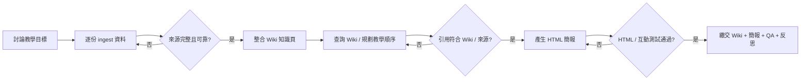

# RAG ATLAS｜以 LLM Wiki 製作教學 HTML 簡報

**主題：RAG（Retrieval-Augmented Generation）是什麼？**  
專案版本：2026-11-22｜語言：繁體中文｜介面：桌機／手機

## 1. 這個專案做了什麼？

- 整理並 ingest **6 份可靠的來源摘要**（1 篇學術論文、5 份官方技術說明／文件），來源索引在 `data/sources.json`，每篇文字紀錄在 `sources/S01.md`–`S06.md`。
- 將來源萃取成 **9 篇具內部連結與來源關係的 Wiki 概念頁**（`wiki/*.md`），可在 `wiki.html` 搜尋與瀏覽。
- 以 Wiki 為內容來源，建立 **14 頁可鍵盤切換、附來源連結、含一題互動測驗** 的 `slides.html`。
- 於 `workflow.html` 說明 graph、重試條件、前移的品質控管與一次 QA 故障注入測試。

**誠實標註：** 這個 Wiki 使用 LLM 協助進行資料摘要與知識編排，且在本專案內已產生 Wiki 資料夾與對應頁面；它是一個**檔案式 LLM Wiki**，不等於已將來源匯入某個外部 LLM Wiki 網站或已部署的線上問答系統。資料筆記是根據原始來源撰寫的摘要，非來源全文。

## 2. 怎麼開啟？

解壓縮後先開啟 `index.html`，其中有三個入口：

| 頁面 | 用途 |
|---|---|
| `index.html` | 專案首頁與導覽 |
| `wiki.html` | 9 篇 Wiki 頁、全文關鍵字搜尋、來源追溯、相關頁面導覽 |
| `slides.html` | 14 頁教學 HTML 簡報，左右鍵與空白鍵切換，支援全螢幕與互動題目 |
| `workflow.html` | Loop / Graph、QA 結果與反思 |

此專案不依賴外部 CDN，不需 API key；除了點原始來源網址需要連網，網頁本體可離線瀏覽。

## 3. 資料清單（來源代號與對應）

| ID | 原始來源 | 最主要支持的知識 |
|---|---|---|
| S01 | Lewis et al., NeurIPS 2020 | RAG 架構與基本定義 |
| S02 | AWS, What is RAG? | 外部知識庫與實際應用 |
| S03 | IBM, What is RAG? | 檢索增強、幻覺與風險 |
| S04 | Microsoft Learn, RAG and indexes | Retrieve / Augment / Generate、索引與錯誤排查 |
| S05 | Ragas, Faithfulness | 回答是否有證據支持的評估概念 |
| S06 | LangChain Learn | 語意搜尋、RAG Agent 與建置方向 |

完整來源網址在 `data/sources.json`，`sources/Sxx.md`，以及 `wiki.html` 的「已 ingest 的資料」。

## 4. Graph / loop



新增來源時：`B → C → D` 重跑。缺少足夠資料：`E → B` 補來源。引用不一致：`F → E` 修改大綱；網頁問題：`H → G` 重生、修復並重測。

## 5. 重現成果與 QA

Python 3（僅標準函式庫）可重建頁面：

```bash
python generate_site.py
python build_check.py
```

`make_data.py` 是已整理完成的初始匯入資料建置腳本；如果想重做整個資料集，才需要執行它，**一般更新請改 `data/*.json`，再執行 `generate_site.py`**。`build_check.py` 檢查來源 ID、Wiki 跨頁連結、slide-to-source 追溯；不保證所有科學主張自動得到語意驗證。

本次做了**受控的故障注入測試**：在第 10 張「Faithfulness」頁的來源清單中，暫時移除 S05，第一次來源追溯檢查失敗；加入 S05 後，7/7 靜態檢查通過。詳見 `logs/qa_before.json`、`logs/qa_after.json`。

瀏覽器功能測試使用 Chromium 的 DOM 渲染／操作，共 **14/14 通過**，包含搜尋、鍵盤翻頁、引用來源、互動測驗與手機版基本可見性。由於執行環境封鎖了 `file://` 與 localhost 網頁導覽，測試使用瀏覽器 `set_content` 注入 HTML/CSS；**未測到部署後的跨頁網路導覽**。請在 GitHub Pages 上線後，以自己的瀏覽器再次點開連結確認。紀錄見 `logs/browser_tests.json`。

## 6. GitHub Pages 發布（取得可繳交網址）

1. 在 GitHub 新增一個 **Public** repository，例如 `rag-atlas`。
2. 解壓縮 ZIP，將**此專案資料夾內的內容**直接上傳 repository 根目錄（不要再多包一層資料夾）。
3. 開啟 repository **Settings → Pages → Build and deployment → Deploy from a branch → main / (root) → Save**。
4. GitHub Pages 啟用後，提供這三個網址：
   - 首頁：`https://<使用者名稱>.github.io/rag-atlas/`
   - Wiki：`https://<使用者名稱>.github.io/rag-atlas/wiki.html`
   - 簡報：`https://<使用者名稱>.github.io/rag-atlas/slides.html`
   - 流程與 QA：`https://<使用者名稱>.github.io/rag-atlas/workflow.html`

`<>` 表示必須換成你的真實 GitHub 帳號。發布後確認四個網址都能開啟，以及投影片下方 Wiki 連結能正確跳頁。**目前專案僅在本機生成，沒有任何已公開網址。**

## 7. 提交前提醒

- 參考 `SUBMISSION.md` 的可貼上內容，填入真實學校、學號、系級、姓名與 GitHub Pages 連結。
- 若老師指定「一定要使用特定 LLM Wiki 平台的 ingest 功能」，請將 `sources/S01.md`–`S06.md` 或原始 URL **再實際匯入該平台**，並附上匯入清單截圖；不能只用這個靜態 Wiki 冒稱平台匯入紀錄。
- 作業要求「先討論、後生成」：目前專案保留範圍規劃說明，但未偽造人機討論對話。若老師要求對話證據，應附上你真正確認主題、受眾、資料範圍與輸出方式的討論紀錄。
